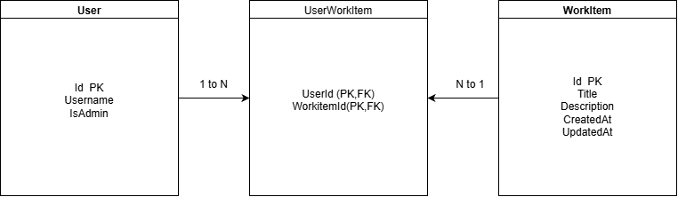

# MyWorkItem

以 ASP.NET Core MVC、EF Core 與 SQL Server 實作的 WorkItem 管理網站，作為 .NET Backend Engineer 面試作品。專案重點是 MVC 分層、關聯式資料模型、使用者項目狀態及整合測試。

## Why This Project

MyWorkItem 最初源自 .NET 後端工程師面試的指定實作題目，
目的是透過實際開發熟悉 ASP.NET Core MVC 與後端系統設計。

我依照題目需求，使用 C#、ASP.NET Core MVC、
Entity Framework Core 與 SQL Server，
實作工作項目管理、使用者確認狀態及管理員操作等功能。

完成基本功能後，我進一步加入整合測試，
並重構測試環境，透過 WebApplicationFactory、
依賴注入（DI）及 SQLite In-Memory
驗證權限控制與資料存取行為。

這個專案讓我累積了從需求實作、架構設計、
測試驗證到 Git 協作開發的實際經驗。

## Features

- **使用者頁面：** 瀏覽清單（每頁 5 筆）、依建立時間排序、查看明細、確認多筆項目及取消自己的確認狀態。
- **管理頁面：** 瀏覽、新增、編輯及刪除 WorkItem；`AdminOnlyAttribute` 對非管理員回傳 HTTP 403。

> **身分限制：** 目前使用 `MockCurrentUserService`，固定為 `UserId = 1`、非管理員；尚未實作登入或正式 Authentication。資料庫中的 Admin 種子資料不會建立已驗證身分。

## Tech Stack

| 領域 | 技術 |
| --- | --- |
| Web | .NET 10、ASP.NET Core MVC、Razor Views |
| Data | EF Core 10.0.12、SQL Server、EF Core migrations |
| Testing | xUnit、`WebApplicationFactory`、SQLite In-Memory |
| UI | Bootstrap、jQuery（專案內含靜態檔案） |

## Architecture

```text
Browser → MVC Controller → WorkItemService → AppDbContext → SQL Server
                 │               │
             Razor View     ICurrentUserService
```

- **Controller** 負責 routes、HTTP 結果與 View；**WorkItemService** 集中處理查詢和業務操作。
- **AppDbContext** 管理 `Users`、`WorkItems`、`UserWorkItems` 與其關聯；Service 和 DbContext 透過 scoped DI 注入。
- **AdminOnlyAttribute** 從 request scope 取得 `ICurrentUserService`，依 `IsAdmin` 決定回傳 403 或繼續處理。

## System Design

### C4 Context

呈現使用者查看／確認 WorkItem，以及管理員管理項目的系統互動。


[Context Diagram 原始檔](Docs/C4context%20diagram.drawio)

### C4 Container

圖中呈現 MVC Web App、EF Core 與 SQL Server；實際程式另有 `WorkItemService`，未在圖中單獨標示。


[Container Diagram 原始檔](Docs/C4%20container.drawio)

### ERD

ERD 展示 User、WorkItem 與 UserWorkItem 之間的關聯。其中 UserWorkItem 使用 UserId 與 WorkItemId 作為複合主鍵，記錄使用者對工作項目的確認狀態。



[ERD 原始檔](Docs/ERD.drawio)

## Testing

測試以 xUnit 和 `WebApplicationFactory<Program>` 啟動測試主機。共用 `CustomWebApplicationFactory` 透過 `ConfigureTestServices` 替換身分服務與 SQL Server 的 DbContext 設定，改用 SQLite In-Memory；每個測試各自建立 Factory 和連線，資料互相隔離，無需本機 SQL Server。

- 非管理員開啟 `/admin/work-items`：**403 Forbidden**。
- 管理員開啟不存在的 `/admin/work-items/999/edit`：**404 Not Found**。
- 管理員開啟已建立 WorkItem 的編輯頁：**200 OK**。

## Getting Started

需要 .NET 10 SDK，以及可連線並有權限更新資料庫的 SQL Server。專案從 `ConnectionStrings:DefaultConnection` 讀取設定；`UserSecretsId` 已設於 `MyWorkItem.csproj`。請在本機設定自己的值，勿提交 Secret：

```powershell
dotnet user-secrets set "ConnectionStrings:DefaultConnection" "<本機 SQL Server 連線設定>" --project MyWorkItem.csproj
```

若尚未安裝 EF CLI：`dotnet tool install --global dotnet-ef --version 10.0.12`。

```powershell
dotnet restore MyWorkItem.csproj
dotnet build MyWorkItem.csproj
dotnet ef database update --project MyWorkItem.csproj
dotnet run --project MyWorkItem.csproj
```

程式不會在啟動時自動套用 migrations。開發 HTTP 網址為 `http://localhost:5154`；HTTPS profile 為 `https://localhost:7198`（設定見 `Properties/launchSettings.json`）。測試指令：

```powershell
dotnet test MyWorkItem.Tests/MyWorkItem.Tests.csproj
```

## Design Decisions

- 以 MVC + Service 分離 HTTP／畫面流程與 WorkItem 操作，並用 ViewModel 傳遞頁面資料。
- 使用 EF Core migrations 管理 SQL Server schema；複合關聯表保存使用者確認狀態。
- 使用 SQLite In-Memory 驗證 MVC 路由、filter、資料存取與 HTTP 結果；SQLite 與 SQL Server 仍可能有行為差異。

## Future Improvements

- 加入正式登入與 Authorization，從已驗證 Claims 取得使用者身分。
- 為 `WorkItemService` 增加排序、分頁、確認和驗證等單元測試。

